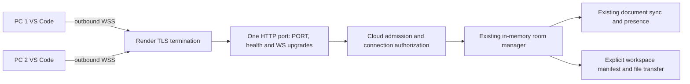

# Cloud relay pilot — 2026-11-01

CodeMesh 0.0.2 adds authenticated cloud collaboration. Nothing has been deployed
or published. Physical two-PC testing and the physical 15-minute test are OPEN.
The [LAN pilot](two-pc-lan-pilot.md) remains available on trusted private networks.

## Architecture and audit



The npm monorepo contains `server` and `extension`. Startup is in
`server/src/index.ts`; `listenConfig.ts` retains loopback/private-interface
validation. `CollaborationServer.ts` owns room messages, revision sync, presence,
workspace publications and file transfers. `RoomManager.ts` tracks socket
membership. LAN has no identity authentication and permits client identities
for reconnect. Cloud never accepts those identities or room-code-only admission.

`CodeMeshClient.ts` retains connection/reconnect, document sessions, one-in-flight
edits, conflicts and draft preservation. `registerCommands.ts` retains explicit
sharing, preview, import, refresh and recovery. Production DOCUMENT_EDIT /
DOCUMENT_ACK / DOCUMENT_CONFLICT and relative paths remain unchanged.
`DocumentSyncSession.ts`, file import/access validation and `prototypes/yjs`
were not changed. Text/file caps remain 256 KiB, messages 2 MiB. The packaging
workflow stages complete `ws`/`ignore` runtime packages and independently loads
modules from the extracted VSIX outside the checkout dependency tree.

Cloud access requires an operator host key of at least 32 bytes, randomly
generated as below. Only that key creates rooms. The host issues 256-bit random
bearer invitations: five minutes, one use, one outstanding invitation per room.
Possession of the privately delivered invitation is the secure admission
mechanism; there is no additional host approval dialog. Guests never need the
host key. Room IDs identify rooms and confer no access. Server-generated UUIDs
replace supplied participant IDs. Names are not verified real-world identities. Cloud members carry a server-set
[host] or [guest] badge; reserved brackets/bidi controls and duplicate names in
one room are rejected. Only server-granted host authority issues invitations.

Each socket is bound to an authorized participant and room. Every privileged
inbound message passes that check and existing message/session validation.
Outbound room data also requires current, unexpired membership. Reconnect uses
a separate 256-bit credential bound to the original identity and room; successful
resume rotates it and concurrent use fails. Credentials are hashed in memory,
never put in relay URLs or logs, and expire eight hours after original admission.
Leave invalidates that credential. Host Leave invalidates all guest credentials.
Revoke Invitations cancels unused links only. An empty room retires all its keys.

Limits: 32 host sessions, 256 participant credentials, eight active members/room,
64 WebSockets, 128 HTTP connections, 120 upgrades/minute globally,
120 messages/second and 4 MiB decoded text/second/socket. Ten rejected messages
close the connection; only the first three rejection errors are logged.
Heartbeat detects dead sockets; unauthenticated sockets expire within about 30
seconds. Receivers above 4 MiB queued output are terminated. Existing two-open-
path/member and pending-file-request limits remain. SIGTERM/SIGINT stop listeners
and close sockets, with forced cleanup after two seconds. Cloud errors are generic.
Origin and forwarded IP headers are never authorization credentials.

## Exact Render Dashboard deployment — manual only

Prepare a private Git repository containing this checkout. This workspace had
no Git metadata during implementation, so no commit or push was performed.
This table assumes the repository contains `codemesh/package.json`. If you make
the contents of `codemesh` the repository root, leave Root Directory blank.

1. Validate locally using the commands below. Commit source and lockfile, never
   real keys, `.env`, temporary TLS files, `node_modules` or pilot source data.
2. Generate the operator host key on PC 1 without printing it into terminal logs:

   ```powershell
   node -e "process.stdout.write(require('node:crypto').randomBytes(32).toString('base64url'))" | Set-Clipboard
   ```

   Paste into Render's secret environment field and your password manager.
   Later use the same key in PC 1's CodeMesh password prompt. Never send it to
   guests. Clear the clipboard afterward: `Set-Clipboard -Value ''`.
3. Render Dashboard → New → Web Service → connect the private repository. Set:

   | Dashboard field | Value |
   | --- | --- |
   | Name | `codemesh-relay-pilot` (or an available pilot name) |
   | Language / Runtime | `Node` |
   | Branch | Your reviewed pilot branch |
   | Region | One region near both developers |
   | Root Directory | `codemesh` for the layout described above |
   | Build Command | `npm ci --include=dev && npm run compile -w server` |
   | Start Command | `npm run start -w server` |
   | Instance Type | Choose your desired plan; exactly one instance |
   | Health Check Path (Advanced) | `/health` |
   | Auto-Deploy | `Off` |
   | Scaling | Manual, one instance, no autoscaling |

4. Add the variables below, leave LAN listener settings absent, then manually
   create/deploy the service. Require the authenticated-relay readiness log and
   healthy deployment before distributing invitations.
5. Open `https://<your-service>.onrender.com/health`: require HTTP 200 and
   `{"status":"ok"}`. Never put a token or room ID in an HTTP URL.
6. Configure connectionMode `cloud` and `wss://<your-service>.onrender.com` in both clients. Do not add a
   second listener, tunnel, router port forward or firewall exception.

Render terminates TLS and forwards HTTP/WS traffic to `0.0.0.0:$PORT`. The pilot
must stay behind that TLS endpoint; it does not provide its own public TLS
listener. Sources: Render [port binding](https://render.com/docs/web-services#port-binding),
[WebSockets](https://render.com/docs/websocket),
[health checks](https://render.com/docs/health-checks).

## Environment and settings

| Variable | Cloud value/rule |
| --- | --- |
| `CODEMESH_MODE` | Required `cloud`; unset defaults to LAN with private-listener validation |
| `CODEMESH_HOST_KEY` | Required random secret, at least 32 UTF-8 bytes; no default |
| `PORT` | Supplied by Render; integer 1–65535; required in cloud mode |
| `NODE_ENV` | Set `production` |
| `NODE_VERSION` | Set `24.13.1`, the local build/test runtime |
| `CODEMESH_HOST`, `CODEMESH_PORT` | Absent in cloud; conflicting LAN settings reject startup |
| `RENDER` | Set by Render; `RENDER=true` prevents LAN startup |

Unknown mode, missing/short host key, invalid PORT or conflicting LAN settings
fail startup. Production requires explicit cloud mode. No production test bypass
exists. Local TLS tests generate temporary certificates and trust them only in
the test subprocess, without disabling certificate verification.

Both clients use these **User** settings, with their actual relay/name:

```json
{
  "codemesh.connectionMode": "cloud",
  "codemesh.serverUrl": "wss://<your-service>.onrender.com",
  "codemesh.invitationUrlBase": "vscode://codemesh.codemesh/join",
  "codemesh.displayName": "PC 1 or PC 2"
}
```

The default connectionMode is `lan`, preserving existing WS and WSS LAN clients.
Explicit `cloud` mode requires WSS. Opening an invitation selects cloud mode for
that client session after confirmation. Set mode back to `lan` and reload when
returning to local development.

Invitation base targets this installed extension, not a production website.
`vscode-insiders://codemesh.codemesh/join` also supports Insiders. Other handlers
and routes fail validation. Embedded relay URLs require WSS and normal TLS
verification, without credentials, query or fragment. URI handling uses the
[documented VS Code API](https://code.visualstudio.com/api/references/vscode-api#window.registerUriHandler).
The recipient reviews the relay before connecting. Cancelling makes no
connection. Opening an invitation does not import, overwrite, save or execute
code. Clipboard managers and OS/browser URI history may retain a link; it is a
secret. Paste into Join Room if the OS does not launch the URI.

## Build, package and install

On PC 1 from the `codemesh` checkout:

```powershell
npm ci
npm run compile
npm run test:cloud
node --test server/test/listen-config.cjs extension/test/lan-pilot.cjs
node extension/test/live-sync-acceptance.cjs
npm run package:cloud-vsix
npm run verify:cloud-vsix
Get-FileHash .\artifacts\codemesh-0.0.2-cloud-pilot.vsix -Algorithm SHA256
```

Cloud tests need OpenSSL on PATH, or Git for Windows in its default location.
The production runtime adds no dependencies. VSIX includes compiled modules,
manifest, icon, README and complete `ws`/`ignore` runtime files and licenses.
It excludes server, tests, temporary TLS keys and Yjs. Archive verification loads
all compiled modules with VS Code stubbed and dependency resolution restricted
to the extracted artifact; this is not native editor activation.

Copy the **same file** to `C:\CodeMeshPilotInstall` on both PCs; compare hashes.
Both must install version 0.0.2. Example physical-machine commands:

```powershell
# PC 1
code --install-extension C:\CodeMeshPilotInstall\codemesh-0.0.2-cloud-pilot.vsix --force
New-Item -ItemType Directory -Force C:\CodeMeshCloud-A\src | Out-Null
Set-Content -LiteralPath C:\CodeMeshCloud-A\src\shared.txt -Value 'Cloud pilot baseline' -Encoding ascii
code --new-window C:\CodeMeshCloud-A
```

```powershell
# PC 2
Get-FileHash C:\CodeMeshPilotInstall\codemesh-0.0.2-cloud-pilot.vsix -Algorithm SHA256
code --install-extension C:\CodeMeshPilotInstall\codemesh-0.0.2-cloud-pilot.vsix --force
New-Item -ItemType Directory -Force C:\CodeMeshCloud-B | Out-Null
code --new-window C:\CodeMeshCloud-B
```

Reload existing windows. Use desktop VS Code 1.96+ and independent local roots,
without shared OneDrive/network storage. Disable Auto Save for disk-preservation
checks. Neither PC runs a server or exchanges an IP address.

## Two-network session and acceptance

1. Put the PCs on separate networks, such as broadband and a mobile hotspot.
   Set connectionMode=cloud and the WSS User URL on both, then reload VS Code.
2. PC 1: Create Room, enter operator host key. Successful creation copies an
   invitation. Copy Invite Link issues a replacement when needed.
3. Deliver it privately to PC 2. Open it or paste into Join Room, verify relay,
   then confirm Join. Require two distinct members in both sidebars.
4. PC 1: Share Workspace. PC 2: Preview Workspace File → `src/shared.txt`.
   Confirm preview made no disk file. Import Previewed File → review destination
   → Import. Existing/dirty destinations retain their protections.
5. Both open their own local `src/shared.txt` and Share Current File. Alternate
   unsaved Unicode edits; both buffers change, both disks retain baseline.
6. Compete on an edit. Inspect Differences, dismiss the conflict prompt and check
   the rejected draft survives. Resolve explicitly afterward.
7. Save a separate test-file change on PC 1 and Refresh Shared Workspace. PC 2
   reviews changes and previews/imports explicitly; refresh cannot overwrite it.
8. Disconnect PC 2's network while PC 1 stays connected. Type a draft on PC 2 and
   edit on PC 1. Restore network. Membership resumes; sharing stays paused.
   Explicit re-share surfaces divergence and preserves the local draft.

Physical checklist — all remain OPEN until performed:

- [ ] Same VSIX hash/version on both PCs; record OS and VS Code versions.
- [ ] Separate networks, expected TLS relay, no local server/port forwarding.
- [ ] Invitation Cancel makes no connection; explicit Join succeeds.
- [ ] Bare room code and reused, expired, revoked invitations fail.
- [ ] Separate roots; explicit workspace share, preview, import and refresh work.
- [ ] Unsaved edits flow both ways without automatic disk writes.
- [ ] Conflict dismissal preserves unsaved drafts.
- [ ] Guest outage restores membership only; re-share is explicit.
- [ ] Host Leave disconnects guests and invalidates credentials.
- [ ] Native URI/clipboard behavior and narrow-window review completed.
- [ ] Physical fifteen-minute stability test completed and recorded.

For fifteen minutes, alternate edits at least once per minute. Include a
simultaneous-edit conflict, guest network interruption, refresh and preview/import.
Record start/end times, latency, errors, disconnects, draft recovery and disk
contents. Do not mark physical checks passed from local simulations.

## Failure recovery, rollback and cleanup

- Connection failure: check `/health`, exact WSS URL, Render logs/service status.
  Never switch cloud to WS or expose the unauthenticated LAN protocol.
- Admission failure: request a fresh invitation. Issuing one revokes the previous
  unused link; links expire after five minutes and admit once.
- Reconnect failure: wait up to about 30 seconds for the old socket to expire,
  or request a new invitation. A lost rotated-credential response can require
  rejoining. Credentials exist only in extension memory; reload loses them.
- If every member disconnects, room and credentials disappear. While someone
  remains, a member can resume before eight-hour expiry. Owner disconnect ends
  workspace publication; explicitly share again. No file sharing auto-resumes.
- Restart, deploy, health restart or plan sleep loses all room/session state.
  Create a new room and invitation. Old codes cannot recover it. Render deploys
  replace WebSocket instances.
- Leaked invite: Revoke Invitations. Suspected admitted attacker: host Leave Room
  and create a new room. Leaked host key: rotate the Render secret and manually
  redeploy, invalidating every session. Never paste secrets into logs.
- Rollback: Render service → Events → reviewed cloud-safe deploy → Rollback, or
  manually deploy a reviewed cloud-safe commit. Never roll a public service back
  to the unauthenticated LAN build. If no cloud-safe build exists, suspend/delete
  the service until fixed. Every replacement loses in-memory rooms.
- Cleanup: both Leave Room, decide deliberately whether to save/discard drafts,
  clear invitation clipboard/history, suspend/delete Render service and retire
  its host key. Restore localhost setting/reload only for local development.
  This work added no firewall rules.

## Security limits before public release

Restricted pilot only: trusted relay operator, no end-to-end encryption or
verified accounts. Host key confers operator authority. Bearer invitations admit
whoever redeems them first. Authorized members can read deliberately shared
content and publish/edit room content. Names do not verify real-world identity. Server-set role badges identify host
authority; participant IDs/host privileges are connection-bound.
There is no individual guest removal UI; end the room to revoke admitted guests.

Global resource limits do not prevent distributed denial of service or malicious
authorized collaborators. Public release requires independent security review,
account identity, stronger operational abuse controls and finer revocation.
Render/operator can inspect content. Do not share production secrets. Existing
VS Code tasks/extensions may react when you open imported code; review code and
use Workspace Trust appropriately.

Exactly one instance stores state in memory: no horizontal scaling, persistence,
seamless deployment migration or availability guarantee. Deployment, real OS URI
registration, native editor review, cross-network reachability and physical
stability remain unverified. Local automated results are recorded separately in
[the implementation report](cloud-relay-implementation.md).
